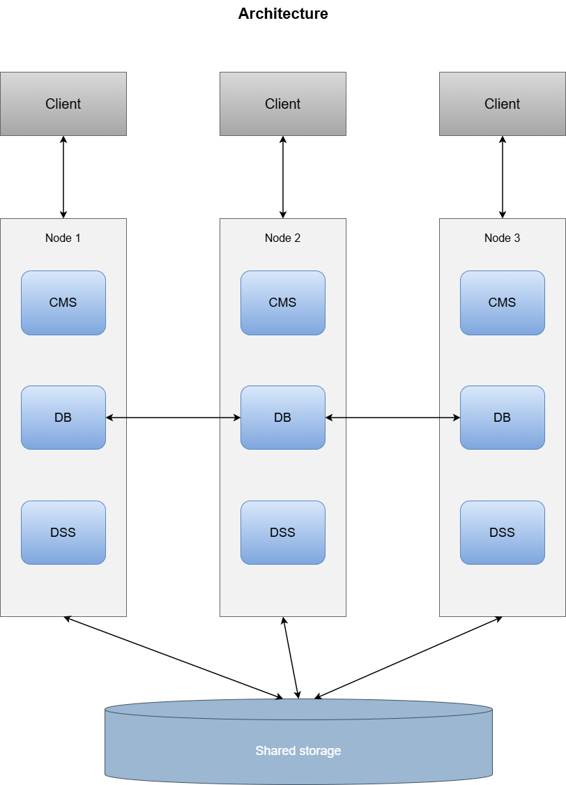
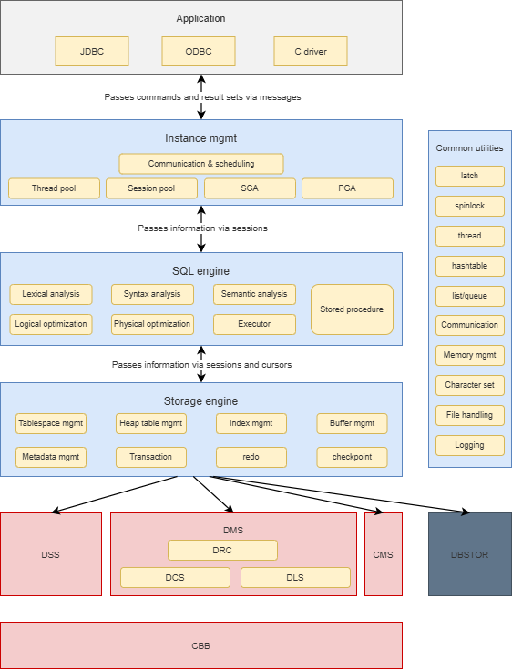

# Architecture Overview

<!-- md-trans-meta sourceCommit=unknown translatedAt=2026-08-05T07:45:09.143Z pushedAt=2026-08-17T00:46:29.609Z -->

## Runtime Architecture

oGRAC uses a shared-storage multi-instance cluster architecture. Each node runs a database instance, CMS, and DSS. Database instances access the same shared data files through DSS and coordinate in-memory state through the DTC execution layer. From the application perspective, any normally opened database instance can accept read and write requests; there is no fixed primary write node.

## Logical Architecture

- Currently supported drivers include the JDBC driver, the oGRAC driver for C, and the ODBC driver. Go and Python drivers will be supported in the future.
- Instance management module: includes communication management and service scheduling, thread pool management, session pool management, global memory management (SGA), and private memory management (PGA).
- SQL engine module: supports lexical analysis, syntax analysis, semantic analysis, logical optimization, physical optimization, executor, and stored procedures.
- Storage engine module: includes tablespace management, heap table management, index management, page buffer management, DC metadata management, transaction management, redo management, and checkpoint.
- DSS (Distributed Storage Service) provides shared file and block-device access based on LUN.
- DMS (Distributed Memory Service) provides cross-instance memory coordination for multi-write clusters through DRC, DLS, DCS, and MES.
- CMS is the cluster management component that maintains member and resource status.
- CBB is a foundational capability library reused by DSS and DMS, covering communication, data structures, security, and file management.
