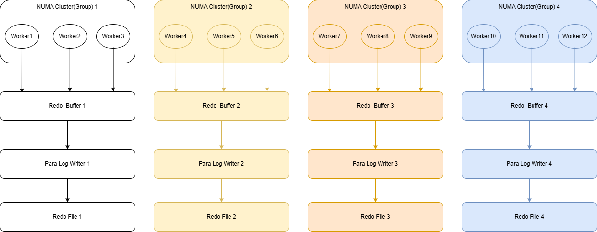
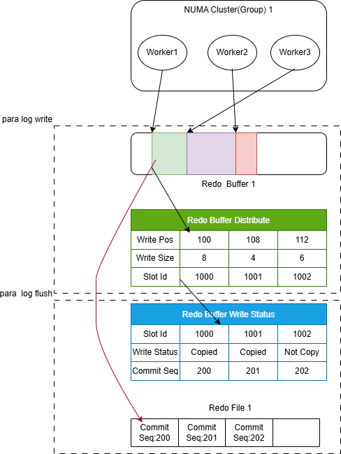

# Parallel REDO Persistence

<!-- md-trans-meta sourceCommit=unknown translatedAt=2026-10-13T02:00:06.811Z pushedAt=2026-10-19T08:31:04.577Z -->

## Core Objectives

In the architecture before oGRAC, the persistence of REDO was mainly completed by a single business thread (agent) or a single redo-writing thread (log_proc). Business threads share the global REDO buffer and a set of REDO files. The REDO of all transactions is assembled and then persisted by the flush thread or the thread that acquires the lock. The entire process is serial. On multi-core servers and in high-concurrency business scenarios, this process of persisting REDO becomes a bottleneck that affects transaction commit. In addition, because the thread that persists REDO is unique, the parallel capability of the multi-core architecture cannot be fully utilized.

Based on the preceding problems, the goal of parallel REDO persistence  (hereinafter referred to as parallel flush) is to divide business threads into multiple groups according to the NUMA affinity of the physical machine, start a flush thread in each group, and enable multiple flush threads in the entire oGRAC to write multiple REDO files simultaneously. The REDO buffers and REDO files of different groups are independent of each other, and the flush logic between groups is also independent of each other, thereby maximizing the parallel capability of the multi-core architecture.

## Working Mechanism

### Feature Description

The overall architecture of parallel flush is shown in the following figure:

The following example uses four NUMA cluster (Group) units. A cluster is a dimension smaller than NUMA. A NUMA can be divided into multiple clusters. For example, the Kunpeng 920B has four NUMAs and 40 clusters. In the parallel flush architecture, each business thread is automatically bound to a cluster. Each flush thread applies for its own REDO Buffer on the cluster, and a set of REDO files is created for each flush thread during database initialization. Business threads write the REDO generated by themselves to the corresponding REDO Buffer, and flush threads persist the REDO to the corresponding REDO files.

Compared with serial REDO persistence, the main changes in the parallel approach focus on the adaptation of functions such as business threads writing REDO (the original log_write logic), flush threads persisting REDO (the original log_commit_flush logic), ckpt, and fault recovery. In addition, the transaction atomicity and consistency of the entire database must be considered, that is, the ACID properties that the database must comply with must be guaranteed. To achieve this goal, within the parallel flush implementation, each cluster has a state table that manages the writing of REDO to the REDO Buffer, and an LSN bitmap array that controls the overall REDO advancement. Whether a transaction can be committed is determined by checking the position to which the globally continuous REDO has been flushed. The schematic diagram is as follows:

### Feature Scope

The parallel flush feature mainly includes the following parts:

- Hardware topology adaptation: automatically identify the number of NUMA nodes and clusters on the current host, as well as the affiliation of each CPU core, determine the number of flush threads to be started, and determine the cluster number to which each business thread needs to be bound.
- Parallel writing of REDO to the REDO Buffer: each business thread preempts a write position in the REDO Buffer through lock-free operations, and the commit order is determined by the preemption order.
- Parallel writing of REDO to the REDO File: one flush thread is used for each cluster to write the contiguous REDO ranges that have been completely written in the REDO Buffer to the REDO file in storage. After persistence is completed, the globally written REDO sequence number is advanced by means of an atomic bitmap.
- CKPT: adapts to CKPT. CKPT uses the flushed LSN to advance, and advances the rcy point after each data page persistence is completed.
- Fault recovery: multiple threads scan the REDO files of each flush thread in parallel, merge them uniformly according to the commit order, replay them continuously, and reclaim them uniformly.

### Constraints and Limitations

Because parallel flush changes the organization of redo data compared with serial flush, parallel flush and serial flush are mutually exclusive and cannot be switched back and forth. Users must decide whether to use parallel flush or serial flush before installing oGRAC, and this choice cannot be changed after installation. If a change is required, the database must be reinstalled and data must be re-imported.

Parallel flush is currently an innovative feature, and the following peripheral features are not yet supported: RBPS, archiving, dual-cluster, logical replication, streaming replication, and RAFT primary/standby mode. Support for these features will be added gradually.

## Related Parameter Configuration

ENABLE_PARA_LOG_FLUSH: whether to enable parallel flush. It can only be modified before database installation.

ENABLE_PARA_LOG_DFX: whether to enable the DFX function of parallel flush, which can print more detailed runtime log information during parallel flush execution.

