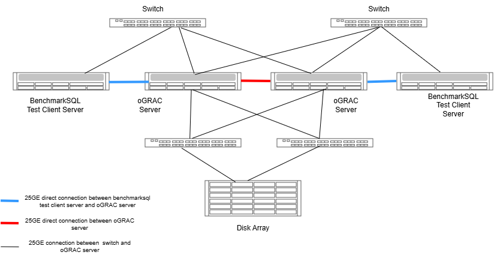
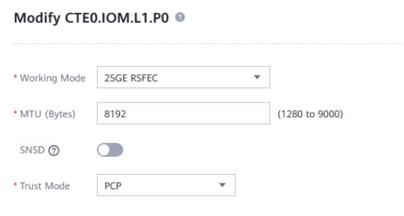
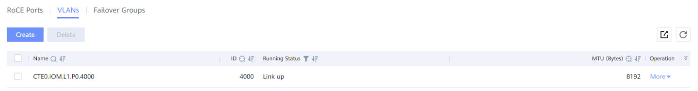
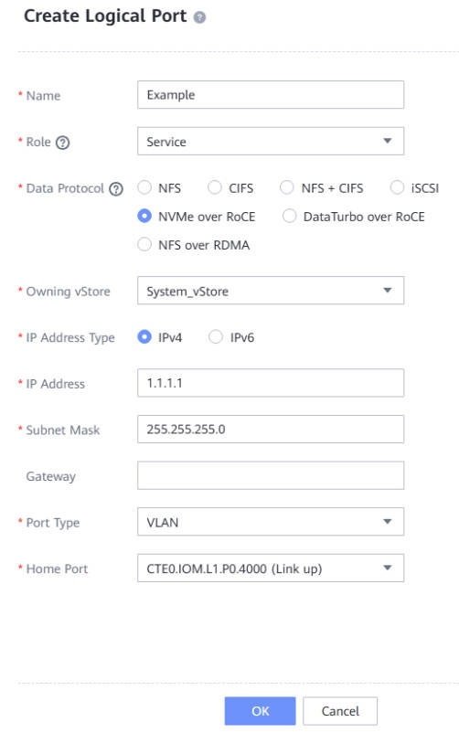
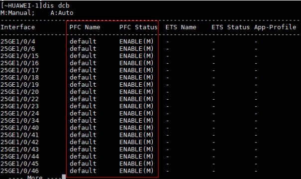

# NoF Connectivity Configuration Guide Based on Kunpeng Servers

<!-- md-trans-meta sourceCommit=unknown translatedAt=2026-10-13T01:59:47.265Z pushedAt=2026-10-19T07:28:29.991Z -->

## Introduction

This section describes the configuration guide for NoF connectivity between servers and storage arrays in a typical configuration consisting of Kunpeng servers, Huawei high-performance NICs, Huawei enterprise-level centralized storage arrays, and Huawei switches.

## Hardware Environment

- Hardware environment requirements:
    |Resource Name|Configuration|
    |:--|:--|
    |Kunpeng server|Kunpeng 920|
    |High-performance NIC| The NIC hardware supports at least 64 queues, supports the RoCE capability, and the recommended models are **Huawei high-performance NICs SP670/SP680/SP681** with a rate of 25GE or above|
    |Storage array| Supports the NVMe Over RoCE/NVMe Over Fabrics capability, and the recommended model is **Huawei centralized enterprise storage array Dorado 18000 V6**; the NICs configured on the storage array must also support the RoCE capability with a rate of 25GE or above|
    |Switch| Supports RoCE, 25GE/100GE, and lossless network configuration|

## Software Environment

- Software environment requirements:
    |Resource Name|Version|
    |:--|:--|
    |OS|openEuler 24.03-LTS SP1|
    |NIC Driver|The latest version released by the Huawei technical support community that matches the OS|

## Networking Mode



## Installing the NIC Driver

1. Obtain the NIC driver: [Huawei High-Performance SP6XX Series NIC Driver Download Link](https://support.huawei.com/enterprise/en/computing/in220-pid-253287505/software/)

2. Install the dependencies required by the ROCE driver on the OS:
```
yum install rdma-core libibverbs nvme-cli
```
3. Upload the driver to the server, decompress it, and then run the driver installation script.
```
sh install.sh nic roce
```
4. Restart the server after the installation is complete. The preceding operations must be performed on all database servers.
```
sync;reboot
```
    
## Storage-Side Configuration

Prerequisite: The RoCE NIC of the storage array is already connected to the switch.

1. Log in to the DeviceManager of the storage, select **Service $\rightarrow$ Network $\rightarrow$RoCE Network**, select the RoCE port that is connected normally, click Operation $\rightarrow$ Modify, and configure it by referring to the following figure. The main configurations are MTU and trust mode.
   

2. Select **Service $\rightarrow$ Network $\rightarrow$RoCE Network**, click VLAN$\rightarrow$ Create, select the RoCE port that is connected normally, and configure it by referring to the following figure:
   

3. Select **Service $\rightarrow$ Network $\rightarrow$ Logical Ports**, click Create, and configure it by referring to the following figure. For the primary port, select the physical port to be configured:
   

## Switch Configuration
    
NVMe over RoCE has high network requirements. The switch must support lossless Ethernet, PFC deadlock detection, suppression/isolation, and so on. The following uses the Huawei CE6865 switch configuration as an example:

1. Enable the PFC function on the switch and configure deadlock detection.
```
[~HUAWEI-1]dcb pfc 
[~HUAWEI-1-dcb-pfc-default]priority 3 
[~HUAWEI-1-dcb-pfc-default]priority 3 deadlock-detect time 10 deadlock-recovery time 15 
[~HUAWEI-1-dcb-pfc-default]priority 3 turn-off threshold 20 
[~HUAWEI-1-dcb-pfc-default]commit
```
2. Add VLAN 4000 on the switch side.
```
[~HUAWEI-1]vlan 4000
[~HUAWEI-1]commit
```
3. Enable the PFC function on the switch ports. All network ports planned for use on the NOF network must be configured.
```
[~HUAWEI-1]interface 25GE2/0/19 
[~HUAWEI-1-25GE2/0/19]undo flow-control
[~HUAWEI-1-25GE2/0/19]dcb pfc enable mode manual 
[~HUAWEI-1-25GE2/0/19]commit
```
4. Configure the port VLAN.
```
[~HUAWEI-1]interface 25GE2/0/19 
[~HUAWEI-1-25GE2/0/19]port link-type trunk 
[~HUAWEI-1-25GE2/0/19]port trunk allow-pass vlan 4000
[~HUAWEI-1-25GE2/0/19]commit
```
5. Verify that PFC is successfully enabled on the ports.

   

## Host Configuration

Prerequisite: The RoCE ports of the host are connected to the switch, and the NIC driver is installed successfully.

1. Edit the RoCE network port configuration file `/etc/sysconfig/network-scripts/ifcfg-enp135s0f0` and configure the IP address as follows (all RoCE network ports must be configured; `enp135s0f0` is used as an example. The UUID is automatically generated by the system and does not need to be copied from the following example):
```
TYPE=Ethernet
PROXY_METHOD=none
BROWSER_ONLY=no
BOOTPROTO=none
DEFROUTE=no
IPV4_FAILURE_FATAL=no
IPV6INIT=no
IPV6_AUTOCONF=no
IPV6_DEFROUTE=no
IPV6_FAILURE_FATAL=no
IPV6_ADDR_GEN_MODE=eui64
NAME=enp135s0f0
UUID=5ed95eb7-c279-4b04-a5ce-5d5e92b5c84e
DEVICE=enp135s0f0
ONBOOT=yes
MTU=8192
VLAN_EGRESS_PRIORITY_MAP=0:3,1:3,2:3,3:3,4:3,5:3,6:3,7:3

```
2. Create a VLAN network port on the RoCE physical port (all RoCE etwork ports must be configured; `enp135s0f0` is used as an example), and define the egress priority. Configure the IP address and VLAN according to the pre-planned settings.
```
echo "BOOTPROTO=static
IPADDR=1.1.1.1
PREFIX=24
IPV4_FAILURE_FATAL=no
NAME=enp135s0f0.4000
DEVICE=enp135s0f0.4000
ONBOOT=yes
MTU=8192
VLAN=yes
VLAN_EGRESS_PRIORITY_MAP=0:3,1:3,2:3,3:3,4:3,5:3,6:3,7:3
" > /etc/sysconfig/network-scripts/ifcfg-enp135s0f0.4000
```
3. Make the modified physical network port and VLAN network port take effect (this operation must be performed on all network ports; `enp135s0f0` is used as an example).

```
[root@server01 ~]# ifdown enp135s0f0
[root@server01 ~]# ifup enp135s0f0
[root@server01 ~]# ifdown enp135s0f0.4000
[root@server01 ~]# ifup enp135s0f0.4000
[root@server01 ~]# ip link set enp135s0f0.4000 type vlan egress-qos-map 0:3 1:3 2:3 3:3 4:3 5:3 6:3 7:3
```

<a id="point1"></a>
4. Configure the PFC and priority queues of the network port (this operation must be performed on all network ports; `enp135s0f0` is used as an example).

```
hinicadm3 qos -i  enp135s0f0 -t dcb -e 1
hinicadm3 qos -i  enp135s0f0 --dev_trust pcp
hinicadm3 qos -i  enp135s0f0 --port_trust pcp
hinicadm3 qos -i  enp135s0f0 -t pfc -e 1 -f 0,0,0,1,0,0,0,0
hinicadm3 qos -i  enp135s0f0 --dev_defcos 3
hinicadm3 qos -i  enp135s0f0 --port_defcos 3
ifdown enp135s0f0
ifup enp135s0f0
ifdown enp135s0f0.4000
ifup enp135s0f0.4000
ip link set enp135s0f0.4000 type vlan egress-qos-map 0:3 1:3 2:3 3:3 4:3 5:3 6:3 7:3
```

<a id="point2"></a>
## Connecting the Host to Storage

Prerequisite: All previous configurations have been completed and succeeded.

1. Load the nof driver and connect to the storage array IP. Use the storage array IP `1.1.1.2` as an example.
```
modprobe nvme-fabrics
nvme discover -t rdma -a 1.1.1.2

## nqn.2020-02.huawei.nvme:nvm-subsystemsn-2102353GTE10L6000001 is the nqn displayed in the discover step
nvme connect -t rdma -a 1.1.1.2 -n nqn.2020-02.huawei.nvme:nvm-subsystemsn-2102353GTE10L6000001 -i 4 -W 4
```
2. Check whether the configuration is correct. hinic0 corresponds to the RoCE NIC of the OS, and it may also be hinic1.
```
watch -d -n 1 "hinicadm3 counter -i hinic0 -t 1 -x 82"
```
If cos3 is displayed, the configuration is correct. Otherwise, the configuration is incorrect. Check all previous configurations.
```
ROCE traffic RX/TX Counter:
ID-0000:tx_bytes_roce_port0_cos0: 0x0000000000003fc0 0000000000000033
ID-0003:tx_bytes_roce_port0_cos3: 0x00000f9900cea7b2 000000014e10bb6d
ID-0020:rx_bytes_roce_port0_cos0: 0x00000000000ef600 000000000000016e
ID-0023:rx_bytes_roce_port0_cos3: 0x0000052f7bff3d98 00000000a9aedbf7

```

## Notes

1. The current ROCE NIC driver does not support installation on OS versions with a 64K page size. Ensure that the OS version uses a 4K page size.
2. After the server restarts, the PFC configuration and the connection to the storage array must be performed again. Configure PFC before connecting to the storage array (that is, perform [step 4 of Host Configuration](#point1) first, and then perform [Connecting the Host to Storage](#point2)). You can also combine the commands into a script and configure it as a system startup service.
