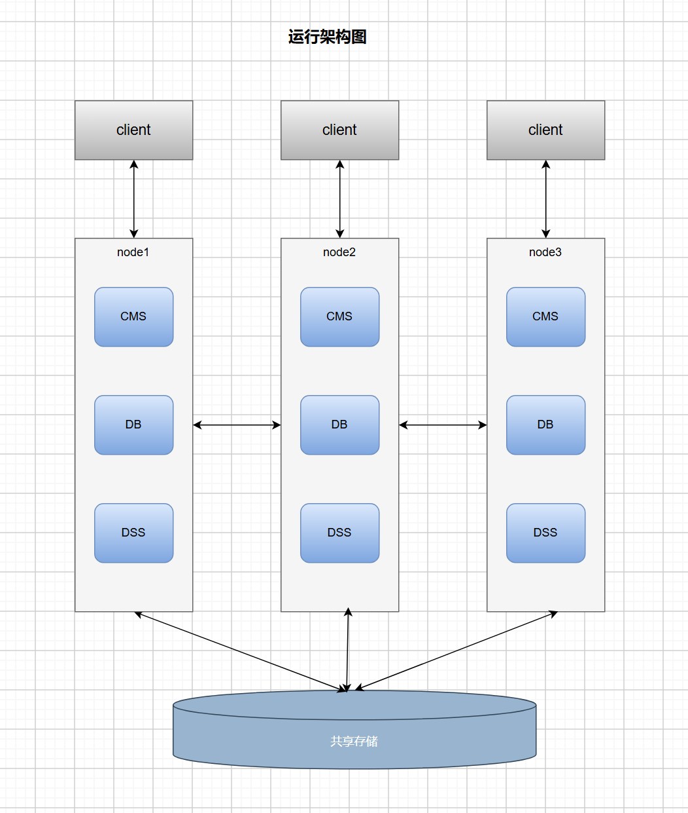
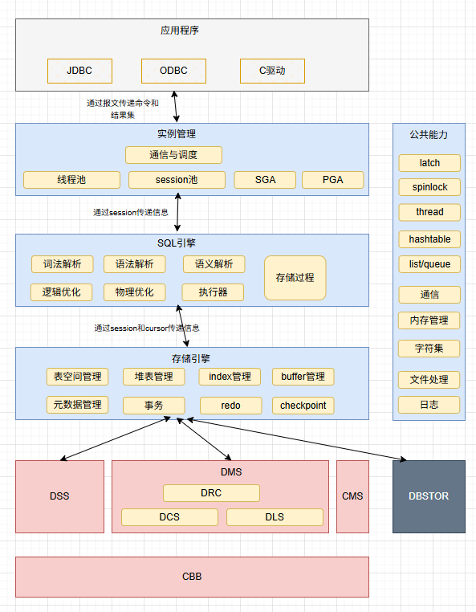

# 产品架构

## 运行架构

oGRAC 采用基于共享存储的多实例集群架构。每个节点部署数据库实例、`CMS` 和 `DSS`，各数据库实例通过 `DSS` 访问同一组共享数据文件，并通过数据库实例内的 `DTC` 集群执行层协调跨节点的内存状态。客户端可以连接任一正常开放的数据库实例执行读写操作，从业务访问角度不存在固定的主写节点。

各进程和模块在运行架构中的位置如下：

- **数据库实例**：负责连接管理、`SQL` 执行、事务处理、本地 `Buffer Pool` 管理和数据持久化。`DTC` 以及 `DRC`、`DCS`、`DLS`、`MES` 等集群能力均集成在数据库实例内，不作为独立进程部署。因此，运行架构图中的数据库实例同时也是多写协调的执行节点。
- **`DSS`**：每个节点上的 `DSS` 服务向数据库实例提供一致的共享文件视图，并通过统一的客户端接口提供文件创建、打开、读写及异步 I/O 等能力。各节点上的 `DSS` 服务共同访问底层共享存储介质。
- **`CMS`**：每个节点上的 `CMS` 进程管理数据库和 `DSS` 等集群资源，维护实例在线状态、工作状态和集群视图。数据库实例向本地 `CMS` 注册并接收成员变化通知。

> [!NOTE]
>
> 说明：
>
> 多写架构中不存在固定的业务写主节点。`DRC Master` 是某个资源分区的目录管理节点；`Page Owner` 是当前由页面目录标记的持有节点，页面锁模式可以是共享（`S`）或排他（`X`），只有持有 `X` 权限时才能修改页面；非页面资源在共享锁模式下可以有多个持有节点；`Reformer` 是根据 `CMS` 集群视图确定的协调实例，负责组织本轮集群重构。`DRC Master` 和 `Page Owner` 因资源而异，`Reformer` 则可能随集群视图变化。

## 逻辑架构

- 当前支持的驱动有 `JDBC` 驱动、C 语言的 oGRAC 驱动和 `ODBC` 驱动，后续还会支持 `Go` 和 `Python` 驱动。
- oGRAC 的实例管理模块包括通信管理和服务调度，线程池管理，`Session` 会话池管理以及全局内存管理 `SGA` 和私有内存管理 `PGA`。
- `SQL` 引擎模块支持词法解析、语法解析、语义解析、逻辑优化、物理优化、执行器以及存储过程。
- 存储引擎模块包括表空间管理、堆表（`Heap`）管理、索引管理、`Page Buffer` 缓存管理、`DC` 元数据管理、事务管理、`Redo` 管理和 `Checkpoint`。

### 多写组件及其关系

| 组件 | 主要职责 | 与其他组件的关系 |
| --- | --- | --- |
| `DTC` | 分布式透明集群（Distributed Transparent Cluster）执行层，统一协调集群页面访问、事务、锁、元数据同步、检查点和故障恢复。 | 位于每个数据库实例内部，在单实例访问路径的基础上增加“本地优先、必要时跨节点协调”的集群处理，并使用 `DMS` 能力完成节点间协作。 |
| `DMS` | 分布式内存服务（Distributed Memory Service），是多写共享集群服务的跨实例内存协调部分，负责维护事务与页面缓存一致性。 | 不作为独立数据库进程部署，其能力主要由 `DRC`、`DCS`、`DLS` 等模块协同提供，并通过 `MES` 传递集群消息；`DMS` 负责内存资源协调，不承担数据持久化职责。 |
| `DRC` | 分布式资源目录，维护页面和非页面锁资源的全局目录。对于页面资源，记录所属分区的 `DRC Master`、`Page Owner`、锁模式、只读副本和脏页副本（`EDP`）；对于非页面锁资源，记录锁模式和持有节点集合。 | `DCS` 和 `DLS` 先向资源对应的 `DRC Master` 申请权限；`DRC` 作出授权、等待、转让或降级决定，但不承载数据页内容。 |
| `DCS` | 分布式缓存服务，处理数据页的共享读（`S`）和排他写（`X`）请求、页面跨节点传输、只读副本失效及脏页副本管理。 | 根据 `DRC` 的目录和授权结果，从当前 `Page Owner` 获取页面，或通知旧副本失效；集群缓存中没有可用页面副本时，再通过 `DSS` 从共享存储加载。 |
| `DLS` | 分布式锁服务，处理表、表空间、索引、序列及其他非页面资源的集群锁和闩锁。 | 使用 `DRC` 记录的锁资源目录协调 `S`、`X` 等模式；发生冲突时通知原持有者释放或降级，再把权限授予新请求者。 |
| `CMS` | 集群管理和成员管理，监测数据库、`DSS` 等资源的状态并维护集群视图。 | 位于控制面，不参与日常数据页读写；当节点加入、退出或故障时通知数据库实例，并由当前 `Reformer` 触发 `DTC Reform`，重建通信关系和资源目录。 |
| `DSS` | 基于 `LUN` 的高性能共享集群文件系统，为各数据库实例提供统一的共享文件和块设备访问接口。 | 共享集群控制文件、系统表空间、双写区和用户表空间；每个实例的 `Undo`、`Temp` 和 `Redo` 相互独立。`DMS` 解决跨实例内存资源的一致性和并发协调，`DSS` 提供统一的底层存储访问。 |
| `CBB` | 公共基础能力库，提供通信、数据结构、文件和安全等通用能力。 | 被 `DSS` 和 `DMS` 复用；它提供通用基础能力，但不承担页面或锁资源的目录管理和权限仲裁。 |

从依赖关系看，`DTC` 是数据库实例内的集群执行层，`DMS` 是其节点间协调能力，`DRC` 提供分布式资源目录和权限仲裁，`DCS`、`DLS` 分别执行页面与非页面锁的跨节点协作；`DSS` 提供统一的底层存储访问，`CMS` 管理成员和生命周期，`CBB` 则为 `DSS` 和 `DMS` 提供共同的基础能力。

### 组件边界和关键术语

- **`DTC` 与 `DMS`**：`DTC` 是数据库实例内面向存储引擎的集群执行层，负责把单实例页面、事务、锁和元数据操作转换为集群操作；`DMS` 提供其中所需的跨节点资源协调和消息交互能力。`DMS` 不把各实例的 `Buffer Pool` 合并为可直接寻址的全局内存，也不负责将数据持久化到存储介质。
- **`DSS` 的职责边界**：`DSS` 向数据库实例提供共享文件和块设备访问。页面所有权、锁模式、事务可见性、缓存副本失效以及脏页转移由 `DTC`/`DMS` 协同处理，不能将 `DSS` 等同于页面并发控制或事务管理组件。`DSS` 的具体部署形态和底层存储实现不改变这一职责边界。
- **`DRC Master`、`Page Owner` 与 `Reformer`**：`DRC Master` 按资源分区选定，负责对应分区的目录管理；`Page Owner` 表示页面目录当前标记的持有实例，实际锁模式可以是共享（`S`）或排他（`X`），只有 `X` 模式具备写权限；`Reformer` 由 `CMS` 发布的集群视图确定，负责组织本轮 `Reform`。三者分别属于资源目录、页面权限和集群重构三个层次，不表示固定的业务主节点。
- **页面副本与页面持久化**：页面可以在多个实例保留受控的共享读副本，但同一时刻只有一个实例持有写权限。页面在实例间转移时通常直接传输缓存内容；只有缓存中不存在可用副本时才从 `DSS` 读取。事务日志先按实例写入各自的 `Redo`，检查点再将符合条件的脏页写入共享数据文件。

从文件布局看，所有实例共同读写一份集群控制文件、系统表空间、双写区和用户表空间，但每个实例拥有独立的 `Undo`、`Temp` 和 `Redo`。正常运行时，实例只能写本实例的 `Undo`、`Temp` 和 `Redo`；构造一致性读页面时可以读取其他实例的 `Undo`，故障恢复时恢复实例可以读取故障实例的 `Redo`。

### DTC 多写读写链路

一次典型的数据页访问按以下链路完成：

1. `SQL` 执行器进入存储引擎的页面访问路径。集群模式下，页面访问由 `DTC` 协调，并优先在本实例的 `Buffer Pool` 中查找目标页面。
2. 本地 `Buffer Pool` 中没有满足目标锁模式的可用页面时，`DCS` 根据页号定位资源分区及其 `DRC Master`，为只读请求申请 `S` 权限，为修改请求申请 `X` 权限。
3. `DRC Master` 查询页面的当前状态。如果集群缓存中没有可用副本，则直接授权，请求实例通过 `DSS` 从共享存储加载；如果页面由其他实例持有，则通知当前 `Page Owner` 向请求实例传输页面。
4. 页面传输响应会携带集群请求版本、`LSN`、`SCN`、脏页标志和页面数据。传输脏页前，原 `Page Owner` 必要时先将保护该页面的相关 `Redo` 刷新至持久化介质；写权限转移后，原 `Page Owner` 放弃写权限，并在需要时将本地旧脏副本登记为 `EDP`。
5. 请求 `X` 权限时，`DCS` 会使其他实例上的只读副本失效，确保同一时刻只有一个实例可以修改该页面；请求 `S` 权限时可以保留多个受控的只读副本。
6. 后续检查点把符合条件的脏页写回 `DSS` 中的共享数据文件。各实例操作同一份逻辑数据库数据集，`DRC`、`DCS` 共同维护各实例缓存副本的一致性；`Undo`、`Temp` 和 `Redo` 则按实例划分，不由所有实例共同写入。

对于一次正常的数据页获取，跨节点访问并不意味着一定从共享存储读取：其他实例存在可用缓存副本时，通常直接通过 `DCS` 在实例间传输；集群缓存中没有可用副本时，才从 `DSS` 装载所请求的数据页。`Redo` 写入、检查点、控制文件访问和故障恢复等其他路径仍会访问 `DSS`。

除数据页之外，`DTC` 还统一处理以下集群级协作：

- **锁与并发控制**：`DLS` 对非页面资源执行集群范围的加锁、释放和降级，避免不同实例同时执行冲突操作。
- **事务可见性**：实例间通过集群消息查询远端事务状态和事务快照，并同步必要的 `SCN` 信息，使 `MVCC` 在多实例环境下保持一致语义。
- **元数据一致性**：`DDL` 操作通过集群广播通知其他实例，使相关数据字典（`DC`）缓存失效或刷新，防止不同实例继续使用过期元数据。

### 集群成员变化和故障恢复链路

节点加入、正常退出或故障时都会触发 `Reform`，但计划内成员变更和计划外故障执行的恢复动作不同：

1. `CMS` 更新资源状态和集群视图，确定本轮 `Reformer` 实例，并通过已注册的回调通知数据库实例；该实例负责本轮重构协调，但不等同于某个页面或资源分区的 `DRC Master`。
2. `Reformer` 触发本轮 `Reform`。`DTC` 暂时冻结需要保护的集群状态，并重新建立存活实例间的 `MES` 通道。
3. `DRC` 执行 `Remaster`，重新划分页面资源和锁资源的 `Master`，并把目录信息迁移到新的管理实例。
4. 计划内节点加入或正常退出的核心动作是资源目录迁移和集群视图同步，通常不执行故障节点的局部 `Redo` 恢复；如果成员状态在过程中转为故障或异常，则按计划外流程处理。对于计划外故障，`Reformer` 读取故障实例的 `Redo` 执行局部恢复，接管其 `Undo` 和事务状态，回滚未提交事务，并更新检查点。
5. 资源目录、事务状态和页面状态重新一致后，实例退出 `Reform`，集群恢复正常读写。

`CMS` 负责发现并发布成员变化，`DTC Reform` 负责协调集群重构，`DRC` 负责重建资源目录，页面、事务和存储恢复机制负责恢复内存与持久化状态的一致性。上述机制共同保证集群在成员变化后重新进入一致状态并恢复服务。

需要区分 `Reform` 与数据库角色切换：`Reform` 关注集群成员视图、通信通道和分布式资源目录的重构，公开的恢复模式主要分为计划内和计划外两类；`failover`、`switchover` 等是数据库角色或高可用操作，不是 `Reform` 的模式名称。`Reform` 期间可能暂时限制部分访问，实际影响取决于成员变化类型、当前恢复阶段和集群状态，不能将其概括为全程无感知或业务持续不中断。

### 一致性读、SCN 与双写保护

- **一致性读**：当查询需要读取早于当前页面版本的数据时，系统根据事务快照和可用的 `Undo` 构造一致性读（`CR`）页面；所需的 `Undo` 可能位于其他实例的实例私有存储中。`CR` 页面是查询视图，不是共享数据文件中的另一份持久化页面。
- **`SCN` 的作用**：集群通过消息传播和推进 `SCN`，结合远端事务状态、事务快照以及 `Undo`/`CR` 机制完成跨实例的 `MVCC` 可见性判断。`SCN` 用于建立一致性边界，不应理解为一个替代事务状态管理的“全局提交序号”，也不等同于应用可见的全局提交顺序。
- **双写区**：共享双写区用于保护数据页的非原子写入。恢复时根据页面标识、页校验和日志序列等信息判断可用副本并修复受损页面；双写区不是用户数据的第二份业务副本，也不替代各实例独立的 `Redo`。

关于多写能力、透明读写、故障恢复和各组件工作机制的进一步说明，请参见[数据库多写能力技术特性概述](technical_feature_overview_of_database_multi_write_capability.md)。
