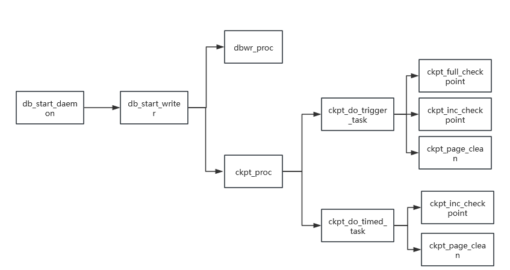

# CKPT

## 核心目标

为了平衡持久性和性能，数据库通常先将数据修改记录到 `Redo`，再由检查点把符合条件的脏页写入数据文件。如果日志文件持续增长，恢复时需要重放更长的日志区间。检查点（`CKPT`）通过推进可恢复日志点、刷新脏页和保存控制信息，缩短恢复需要处理的日志范围；它不等同于一次事务提交，也不要求每次提交都立即写数据页。

## 工作机制

### 关键日志点

oGRAC 的日志点包含 `LFN` 等字段，用于标识日志批次和日志文件中的位置。

`CURR_POINT`：当前日志生成/刷新进度对应的日志位置，不表示所有数据页都已写入数据文件。

`TRUNC_POINT`：与检查点队列中脏页关联的日志截断边界。只有相关脏页已经满足持久化条件后，边界之前的日志才具备回收条件。

`RCY_POINT`：实例控制信息记录的恢复起点，实例异常重启时从该位置开始检查和重放所需日志。

`LRP_POINT`：为保证数据一致性，恢复过程至少需要达到的日志位置。

检查点过程中会先保证与待写脏页相关的 `Redo` 已刷新，再刷新脏页并更新检查点控制信息。`RCY_POINT` 通常推进到仍由最早未持久化脏页决定的安全位置。只有在检查点队列已清空、相关脏页已完成写回并满足持久化条件、检查点控制信息已更新且实例已完成必要的恢复工作后，才可以将 `RCY_POINT` 推进到 `LRP_POINT`；队列为空本身不能单独作为推进条件。启用并行日志刷新时，日志写入和刷新可以并行推进，但不改变上述脏页持久化和检查点完成条件，也不能据此提前回收日志或将恢复起点视为已经持久化。恢复从 `RCY_POINT` 开始，并至少重放到 `LRP_POINT` 所要求的位置。

脏页写回前可先写入共享双写区，再写入数据文件，用于防止数据页非原子写入造成的撕裂页。双写区只承担页面写入保护，不替代 `Redo`，也不是用户数据的第二份业务副本。

在多写集群中，每个实例维护自己的 `Redo` 和检查点进度。共享数据页可能由其他实例持有写权限，检查点会通过 `DCS`/`DRC` 找到 `Page Owner`，通知其按检查点要求刷新页面及对应的脏页副本（包括 `EDP`），再由页面所在实例按检查点流程写入共享数据文件。

### CKPT线程与任务

`ckpt_proc` 为检查点调度线程，负责处理主动触发、定时触发和按脏页数量触发的检查点任务；

`dbwr_proc` 为数据写线程，负责将检查点批次中的页面写入数据文件，并按配置执行同步或异步 I/O；

`ckpt_full_checkpoint` 为全量检查点任务，持续处理检查点队列，直至达到全量检查点的完成条件；

`ckpt_inc_checkpoint` 为增量检查点任务，处理当前批次的检查点队列；

`ckpt_page_clean` 为页面清理任务，清理写回后可复用的页面。

### 增量CKPT

全量 CKPT 需要持续处理检查点队列，直至达到全量检查点的完成条件，并不表示这些页面在同一时刻写入磁盘。对于繁忙数据库，集中处理大量脏页可能造成较高的 I/O 压力，使业务出现短时抖动，并使检查点难以频繁触发、恢复点推进变慢。增量 CKPT 就是为了解决这些问题而生的。

oGRAC 增量检查点的核心思想是：每次只处理当前批次的脏页，并根据脏页数量、时间间隔等条件再次触发后续批次。这样可以限制单次写回工作量，使检查点在持续业务负载下平滑推进。

### 批量并发刷脏页技术

传统的逐页刷新会带来较高的 I/O 调度开销。oGRAC 会将待写脏页组织为检查点批次，执行必要的页面校验，再交由数据写线程批量写入数据文件。

`DBWR_PROCESSES` 控制数据写线程数量；在启用异步 I/O 的环境中，各线程可以并发处理不同批次。批量和并发用于提高写回效率，但不改变 `Redo` 先行和恢复点推进的持久性约束。

## 相关参数配置

`CHECKPOINT_PERIOD`：两次增量 CKPT 之间的间隔时间。

`CHECKPOINT_PAGES`：两次增量 CKPT 之间的脏页数。

`BUFFER_PAGE_CLEAN_PERIOD`：两次 PAGE_CLEAN 之间的间隔时间。

`CHECKPOINT_GROUP_SIZE`：一次增量 CKPT 最多处理的页面数。

`DBWR_PROCESSES`：刷脏页的数据写线程数。

`DTC_CKPT_NOTIFY_TASK_RATIO`：多写集群中，MES 消息处理线程用于检查点 `EDP` 通知的任务比例；这些任务负责处理发往 `DRC Master` 和 `Page Owner` 的相关通知。当前版本默认值为 `0.125`，修改后需重启实例生效。

`ENABLE_QUICK_CKPT`：控制是否采用快速检查点路径；启用后，页面准备线程与数据写线程通过检查点批次流水化衔接，以减少准备阶段对写回阶段的等待。当前版本默认值为 `FALSE`，修改后需重启实例生效。

## 相关视图

### DV_DATABASE

- RCY_POINT: 恢复信息
- LRP_POINT: Least Recovery信息
- CKPT_ID: CHECKPOINT ID
- LSN: 重做日志序列号
- LFN: 重做日志刷新号
- LOG_FIRST: 重做日志开始文件号
- LOG_LAST: 重做日志结束文件号
- LOG_FREE_SIZE: 重做日志可用空间

### DV_SYS_STATS

- CKPT avg merge io: 脏页落盘平均IO合并数
- CKPT last merge io: 脏页落盘最后一次IO合并数
