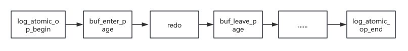

# REDO

## 核心目标

数据库为了性能，数据修改通常先在内存缓冲区完成，再由 `Redo` 和检查点协同完成持久化。`Redo` 记录恢复所需的变更，保证实例异常重启后可以重放已持久化的日志；检查点将符合条件的脏页写入数据文件。事务提交的持久性依赖提交相关 `Redo` 达到持久化条件，并不要求提交时同步写回所有数据页。

## 工作机制

### 日志原子操作

一个逻辑操作可能同时修改多个页面，并产生对应的 `Redo`、`Undo` 和事务状态记录。如果这些记录只完成一部分，异常恢复时就无法正确判断事务和页面状态。因此，oGRAC 将一个原子操作产生的日志记录组织为一个日志组，并在原子操作结束时统一写入日志缓冲区；恢复时按日志组和记录顺序重放，保证操作的恢复边界一致。

页面访问同时受本地页面闩锁和集群页面权限控制：本地闩锁保护实例内的页面并发访问，`DCS` 负责跨实例的 `S/X` 页面权限、页面传输和副本失效。页面离开当前操作后是否降级、释放或保留权限，取决于页面访问路径和后续检查点需求，不能概括为所有页面统一降为共享锁。

### 低竞争日志写入

多个会话在生成日志记录时，如果直接争用同一个日志缓冲区，每条记录追加都可能产生锁竞争；一条逻辑操作包含多次修改时，这种竞争会被放大。

oGRAC 在日志的原子操作开始时，将日志记录写入会话私有的日志组；原子操作结束时，再将日志组复制到实例的日志缓冲区。实例使用多个日志缓冲区分担并发写入，并按会话标识选择缓冲区，减少单一共享缓冲区的锁竞争。日志刷新时将各缓冲区组装为有序日志批次，使用 `LFN`、`LSN` 等位置字段标识顺序，恢复阶段依据日志位置和批次顺序重放。

在多写集群中，每个数据库实例拥有独立的 `Redo` 日志。页面写权限从一个实例转移到另一个实例前，`DTC/DCS` 会在必要时先刷新保护该页面的 `Redo`；发生节点故障时，`Reform` 恢复流程在存活实例中选择恢复实例，读取故障实例的 `Redo` 执行恢复。不同实例的 `Redo` 不是同一份共享日志，也不通过页面缓存副本代替日志持久化。

在默认 `COMMIT_WAIT_LOGGING=WAIT` 时，事务提交会将事务结束记录写入 `Redo`，随后提交路径等待日志刷新达到持久化条件；如果设置为 `NOWAIT`，提交路径可以不等待日志刷新就返回，返回成功不表示相关日志已经持久化。检查点和日志刷新相互配合：`Redo` 提供崩溃恢复依据，检查点通过写回脏页推进 `RCY_POINT` 等恢复位置。

## REDO日志管理

### redo日志文件配置

#### 增加redo日志文件

redo日志切换时会自动找到下一个，如果下一个redo处于active状态则无法切换，称作redo追尾。如果频繁出现redo追尾，会阻塞DML操作，需要增加redo文件。

可以在执行命令的数据库实例上为 `Redo` 增加一个或多个日志文件。只给出日志文件名时，日志文件会添加到默认路径下；
添加日志文件的时候，也可以设置绝对路径。

添加redo日志文件的命令如下：
ALTER DATABASE ADD LOGFILE
( { 'file_name' SIZE integer [ K | M | G | T | P | E ] 
 } [ , ... ] 
);

例如：ALTER DATABASE ADD LOGFILE ( 'testfile1' SIZE 2G BLOCKSIZE 1024);
      ALTER DATABASE ADD LOGFILE ( '/mnt/dbdata/local/ograc/tmp/data/testfile2' SIZE 2G BLOCKSIZE 1024);

#### 删除redo日志文件

可以在执行命令的数据库实例上删除 `Redo` 日志文件，一次只能删除一个日志文件。直接使用文件名时，会自动补齐默认日志文件路径。

删除redo日志文件的命令如下：
ALTER DATABASE DROP LOGFILE ( 'file_name' );

例如：ALTER DATABASE DROP LOGFILE ( 'testfile1' );
      ALTER DATABASE DROP LOGFILE ( '/mnt/dbdata/local/ograc/tmp/data/testfile2' );

#### 注意事项

- 创建和删除REDO必须通过SQL命令，不允许直接操作REDO文件
- 数据库处于 `OPEN` 且允许读写时，才允许添加或删除 `Redo` 日志文件；启用 `ENABLE_PARA_LOG_FLUSH` 时不允许执行这两类操作
- REDO日志文件数量限制最大256，最小3
- 添加/删除 `Redo` 时会持有相关 DDL 和日志资源，其他 DDL 可能等待；日志切换或刷新阶段也可能使相关 DML 短暂等待，建议在业务低峰操作

在多写集群中，`Redo` 文件按数据库实例分别管理。`ALTER DATABASE ADD LOGFILE` 和 `ALTER DATABASE DROP LOGFILE` 仅修改执行命令实例的日志配置，不参与普通逻辑 DDL 广播；如需调整多个实例的日志容量，必须分别在目标实例执行，并确认各实例的日志空间和恢复能力。
