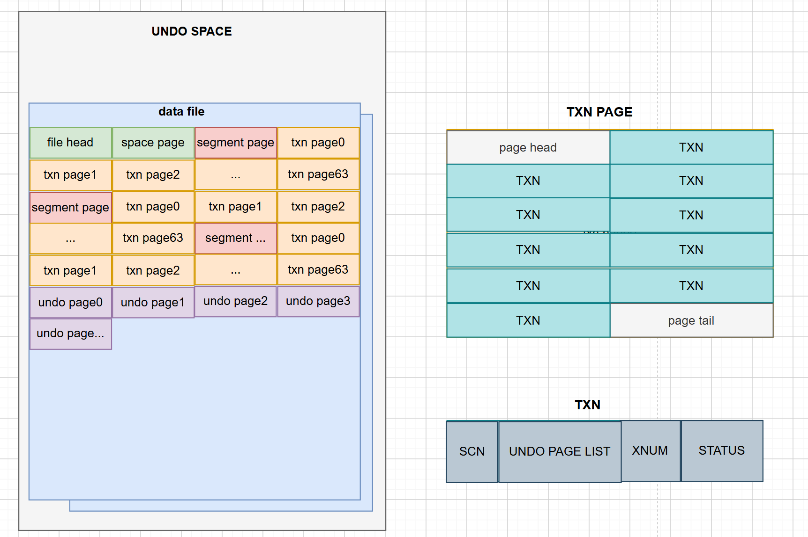
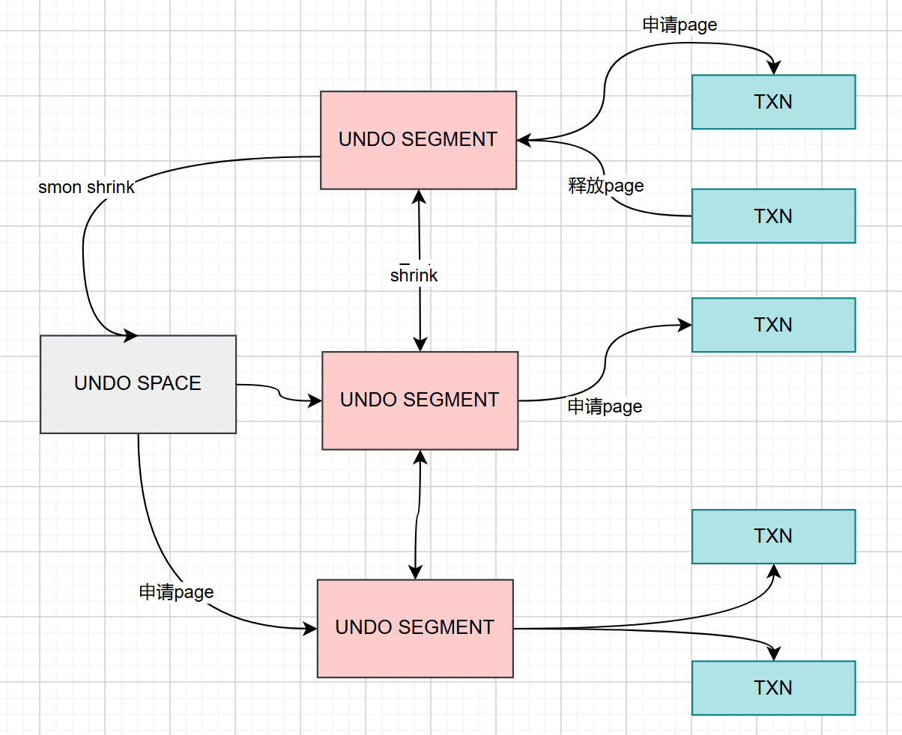
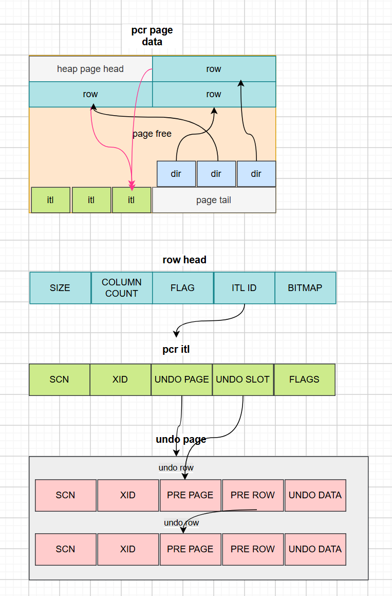
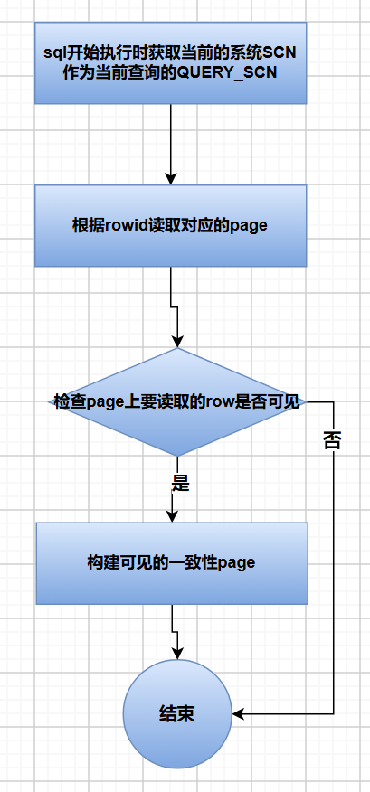
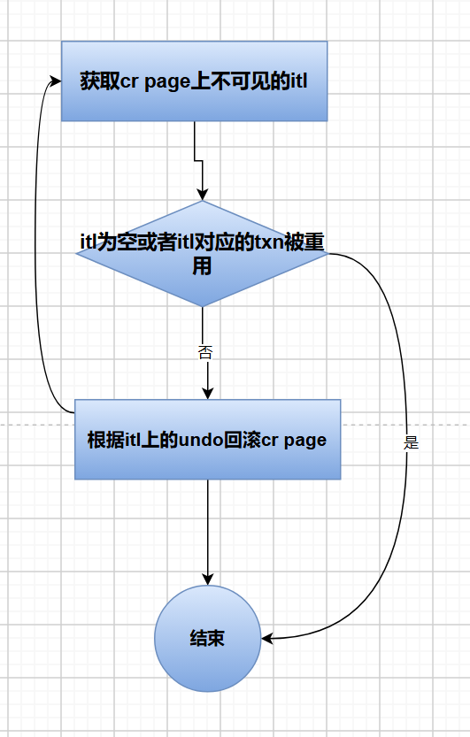
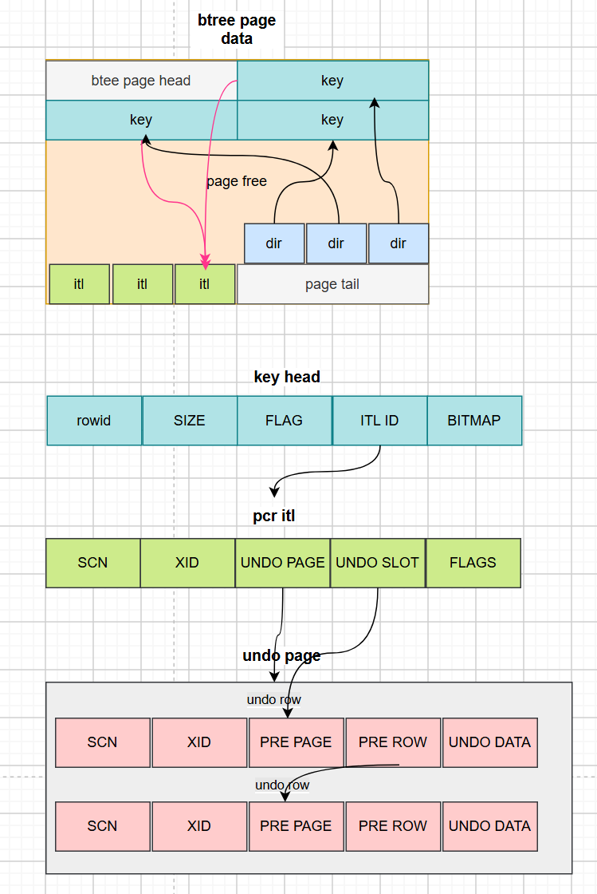

# 事务机制

事务机制保证用户的操作的原子性，一致性，隔离性和持久性，即满足ACID要求。
通过以下技术实现ACID：

- Undo机制 记录用户每条记录的原始数据，回滚时可以用undo进行恢复，保证用户操作的原子性。
- Row Lock机制  通过行锁保证不会同时修改同一行记录。
- 可见性判断 通过查询快照、事务状态和记录版本的SCN共同判断记录是否可见。SCN（System Change Number）是 64 位的时间序列值，由秒、微秒和序列字段组成，用于建立时间和可见性边界；多实例环境通过集群消息推进各实例的SCN，不能将SCN理解为替代事务状态管理的独立全局提交序号。
- Redo机制 记录数据页、事务状态及相关元数据的持久化变更。事务提交时，提交相关的Redo必须按持久性要求刷新；数据页由检查点按照恢复点规则写回数据文件。

## 事务管理

### 事务表

事务表是所有事务信息的集合。

事务表的存储结构如下：

开启事务时会占用一个TXN空间，TXN存放到TXN PAGE里，TXN page由undo segment管理，每个undo segment管理64个TXN page，undo segment缺省有32个，可以配置。undo segment信息存放到undo space里。undo space除了存放undo管理信息还存放undo page数据。undo page里存放undo row。

TXN由事务状态（标识事务提交与否），事务版本（TXN重用时区分不同的事务），SCN和undo page链表入口（存放undo数据）组成。

### 回滚段管理

当用户操作需要写undo时，需要到这个事务绑定的undo segment上申请undo page，如果undo segment没有可用的page，则需要到undo space上申请。当undo space上也没有空间则尝试从其他undo segment释放undo page。

如果设置了自动收缩undo segment选项，后台线程也会定期将有空闲undo page的segment释放一些page回undo space。

### 事务开启

oGRAC是隐藏式启动事务，没有start transaction语句，是在用户调用修改类SQL时自动启动事务。

oGRAC开启事务时会返回一个XID，这个XID由xmap和xnum组成，xmap相当于存放一个事务信息TXN的地址，xnum相当于是这个地址的重用版本号。

开启事务分配TXN时，先随机绑定一个undo segment，然后在这个undo segment上free txn链表里的选取一个TXN。

### 事务结束

oGRAC在以下场景会结束事务：

1. 用户手动执行commit或者rollback来提交或者回滚自己开启的事务；
2. 用户执行DDL操作，会自动将当前会话没有结束的事务进行提交；
3. 客户端异常退出，服务端会把异常退出的会话没有结束的事务回滚；服务端故障重启时也会自动回滚没有结束的事务；
4. 客户端正常退出，根据客户端的缺省设置是自动提交事务。
结束事务时，oGRAC会设置TXN上事务的SCN，事务的状态，会释放事务占用的undo page到undo segment，会通知等待它结束的其他事务，会释放锁资源，释放TXN事务资源，重置事务资源管理上下文。

### 多实例事务协作

在多写集群中，事务状态并不只存在于发起请求的实例：

1. 事务标识包含实例归属信息。当前实例访问其他实例创建或管理的事务时，`DTC` 通过集群消息查询远端事务状态和事务快照，并在必要时推进本地 `SCN`。
2. 各实例正常运行时写入本实例的 `Undo` 和 `Redo`。构造一致性读页面时可以读取其他实例的 `Undo`；节点故障后，`Reform` 恢复流程在存活实例中为故障实例建立事务区域，并执行未提交事务回滚。
3. 提交过程为事务分配提交 `SCN`，记录事务结束信息并写入 `Redo`，随后等待日志达到持久化条件。提交并不等同于立即把所有脏数据页写入共享数据文件。
4. `DDL` 事务除记录持久化变更外，还会生成逻辑 DDL 信息。集群模式下，`DTC` 将该信息广播给存活实例，由其他实例重放逻辑操作并使相关数据字典缓存失效或刷新。

远端事务查询、页面一致性读和 DDL 广播均依赖 `MES` 通信；通信失败或目标实例不可访问时，访问不会被当作本地事务直接处理，而是按集群状态进行等待、重试或报错。

### Savepoint

SAVEPOINT（保存点） 是事务内的一个标记点，用于在事务执行过程中设置中间节点。通过保存点，可以在事务出错时，只回滚到指定的标记点，而不必放弃整个事务的所有操作，从而提高事务处理的灵活性。
设置savepoint时，oGRAC在事务资源管理上下文上登记当前事务的undo row信息和使用的锁信息。执行回滚到save point操作时回滚undo到savepoint登记的undo row和释放锁从save point登记的锁开始。

## 事务隔离级别

oGRAC支持的事务隔离级别为读已提交和可串行化。

部分内部数据维护路径可以使用“当前已提交”视图读取，以限制长时间持有快照的范围；这属于内部执行策略，不是面向用户新增的事务隔离级别。

### 读已提交（Read Committed）

RC隔离级别保证事务访问其他事务修改数据时，只能读取已提交的数据版本。避免出现脏读，但存在不可重复读现象。

### 可串行化

此隔离级别下，系统会对事务快照和并发修改进行更严格的检查；当检测到不满足可串行化要求的并发访问时，事务可能等待或失败。该隔离级别并不意味着事务之间不存在锁冲突。

## MVCC（多版本并发控制，Multi-Version Concurrency Control）

MVCC 的解决方案是：为数据维护多个版本，读操作可以访问符合快照要求的历史版本，写操作修改当前版本，在满足并发控制条件时减少读写相互阻塞。
oGRAC的MVCC 依赖 `Undo` 数据、事务状态和 `SCN` 协同工作，通过版本数据和事务快照实现多版本访问。
oGRAC通过MVCC为读已提交和可串行化隔离级别提供版本可见性基础；可串行化语义还依赖相应的并发控制检查。

### HEAP MVCC

oGRAC使用的是页面级的一致性读，就是先构建可见的页面再读取行数据。

页面里的dir记录对应row的offset页面位置。

事务在page上增删改时需要申请一个itl用于对这个page上的记录的管理和锁定，page上的一个itl可以管理同一个事务的多个row。

事务修改page上的row数据时写undo row，undo row记录修改之前的数据，用链表的方式串联起来。itl上登记最后的undo地址。row head上登记使用的itl id，每行row可以根据这个itl id找到对应的itl信息。

#### Heap fetch row 可见性判断流程

##### Heap fetch根据rowid获取row时的可见性判断流程

1. SQL 开始执行时获取当前实例的系统 `SCN` 作为查询的 `QUERY_SCN`；跨实例访问前，`DTC` 会按需要推进本地 `SCN`，使查询使用不落后的可见性边界。
2. 检查页面上的行是否可见时，先根据行头记录的 `ITL` 定位事务信息。`ITL` 被重用后，页面保存的页面级提交信息用于辅助判断；仅释放锁但未修改数据的场景也需要按事务状态判断。
3. 如果 `ITL` 合法，则结合 `ITL` 状态、事务表中的版本号和事务状态判断事务是否仍有效。事务状态查询可能需要通过 `DTC` 获取远端事务信息，不能只读取本地事务表。
4. 未提交事务的版本对其他事务不可见；当前事务按照自身事务规则处理。已提交事务的提交 `SCN` 小于等于 `QUERY_SCN` 时，行版本可见，否则需要继续构造一致性读页面。
5. 如果还是不可见，需要构建一致性读的page来获取可读的row记录。

##### 构建一致性读的page流程

1. 将当前的heap page拷贝一份到cr page上，cr page从cr page pool申请。
2. 获取page上的不可见itl时，如果itl对应的txn上的事务已经提交同时TXN已经被重用，需要报snapshot is too old错误；否则获取一个没有提交的itl或者SCN大于QUERY_SCN的itl；如果没有满足的itl直接返回cr page构造结束。选取已经提交的itl时，先选取SCN大的先回滚，防止事务间有依赖关系。
3. 如果 `ITL` 对应的事务不在本节点，则通过 `DTC` 请求对应实例读取事务状态或 `Undo`，由持有相关事务区域的实例协助构建 `CR` 页面。
4. 回滚itl对应的undo row时，一直回滚到itl的undo为止。

### BTREE MVCC

btree页面的mvcc的处理跟heap页面类似，但btree的itlid存放在key head上。
